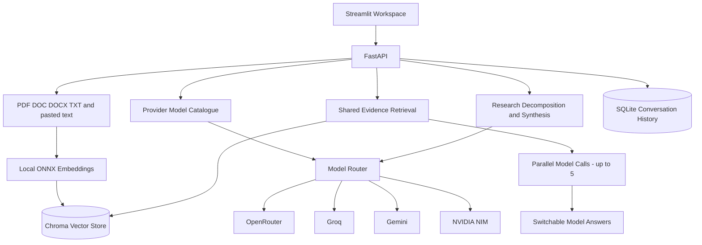

# ResearchFlow AI

ResearchFlow AI is a local, document-grounded research workspace built with Python, LangChain, LangGraph, FastAPI, ChromaDB and Streamlit. It supports multi-provider model discovery, parallel answer comparison and source-aware research over uploaded documents.

## Features

- PDF, DOC, DOCX and TXT upload, plus a paste-text flow for copied research notes.
- Text extraction, recursive chunking and source metadata; PDF page references and Word/TXT section references.
- Persistent Chroma vector storage with local ONNX embeddings (no paid embedding API or PyTorch requirement).
- Multi-provider model library for OpenRouter, Groq, Google Gemini and NVIDIA NIM.
- Live model discovery from all four provider catalogues, including both free and paid text/chat models; common non-chat families are filtered out.
- Only OpenRouter models explicitly priced at $0 are preselected by default; all paid models remain manually selectable.
- Provider billing/quota/access failures are caught per model and temporarily hide that model from chat/research selection for 30 minutes; no automatic paid fallback or credit purchase is performed.
- Select up to five models and ask one question; all selected models receive the same retrieved evidence and answer in parallel.
- Switch between model answers in separate tabs; each answer shows provider, response time, citation-name check and shared evidence references.
- Evidence-first answer prompts that prohibit unsupported facts and citations, plus an insufficient-evidence guardrail.
- Research Studio lets the user select one configured model for question decomposition, evidence gathering and report synthesis.
- LangGraph workflow for the original single-model chat path: query analysis -> retrieval -> evidence evaluation -> retry -> answer generation -> review.
- SQLite conversation history and Streamlit workflow trace.

## Architecture



## Requirements

- Windows 10/11
- Python 3.14 (current environment tested on Python 3.14).
- Optional API keys for the providers you want to use.
- Microsoft Word with pywin32 automation or Antiword for legacy binary .doc files. DOCX works through python-docx.
- Internet connection for dependency installation, provider calls and first-time local embedding model initialization.

## Windows PowerShell setup

```powershell
cd D:\AI-Projects\ResearchFlow-AI
py -3.14 -m venv .venv
.\.venv\Scripts\Activate.ps1
python -m pip install --upgrade pip
pip install -r requirements.txt
Copy-Item .env.example .env
```

Add only the provider keys you intend to use to the local .env file:

| Provider | Environment variable |
|---|---|
| OpenRouter | OPENROUTER_API_KEY |
| Groq | GROQ_API_KEY |
| Google Gemini | GEMINI_API_KEY |
| NVIDIA NIM | NVIDIA_API_KEY |

The app never needs keys in frontend code. Keep .env private and do not commit it. Restart the backend after changing keys. The Model Library checks provider model catalogues at backend startup/first catalogue request and caches discovered models for that backend process; restart the backend to refresh the list.

## Run backend

```powershell
uvicorn app.main:app --host 127.0.0.1 --port 8001
```

API docs: http://127.0.0.1:8001/docs

## Run frontend (second terminal)

```powershell
cd D:\AI-Projects\ResearchFlow-AI
.\.venv\Scripts\Activate.ps1
streamlit run frontend/streamlit_app.py --server.address 127.0.0.1 --server.port 8502
```

Open http://localhost:8502.

## Model ranking: read this before trusting a score

The current catalogue score is a **transparent research-fit heuristic**, not a claim that one model is objectively best. It scores context capacity (25 points), reasoning-family signals (25), model-capability/scale signals (25), speed-oriented variants (10), and preview/stability signals (15). The recommender selects up to five high-fit candidates while preferring provider diversity. This is useful for shortlisting only: model-name signals are imperfect and do not measure factual accuracy, citation quality, or reasoning performance. The catalogue includes paid and free models; OpenRouter pricing is shown when supplied by its catalogue, while other providers' billing and quotas depend on the account and model. ResearchFlow does not buy credits or switch providers automatically. A provider may still charge if the account has billing or credits enabled; do not treat a missing card as a universal guarantee.

A reliable ResearchFlow leaderboard should use a fixed evaluation set of representative document questions and the same retrieved excerpts for every model. Recommended score:

- 35% evidence accuracy: factual claims are supported by the supplied document excerpts.
- 25% citation precision: cited filenames/pages exist and the cited passage supports the claim.
- 20% answer completeness and reasoning: a rubric or blinded human preference evaluation.
- 10% reliability: successful responses, valid formatting and no unsupported claims.
- 10% latency and cost: measured response time and token cost.

Use multiple independent graders plus occasional human review; do not let one model grade itself. Store per-model results and report sample size/confidence so a model with one lucky answer does not jump to #1. The UI explicitly labels current scores as provisional until this evaluation data exists.

## API endpoints

| Method | Endpoint | Purpose |
|---|---|---|
| GET | /health | Health check |
| GET | /models | Curated and provider-discovered models, configuration status |
| POST | /documents/upload | Upload PDF, DOC, DOCX or TXT |
| POST | /documents/text | Index pasted/copied text |
| GET | /documents | List indexed documents |
| DELETE | /documents/{document_id} | Delete document chunks and uploaded file |
| POST | /compare | Ask one question of 1–5 models in parallel |
| POST | /chat | Existing single-model conversation chat |
| POST | /research | Multi-step research using a selected model |
| GET | /conversations | List saved conversations |
| GET | /conversations/{id}/messages | Read conversation messages |

### Compare request

```json
{
  "question": "Compare the evidence for the main claims in these papers.",
  "model_ids": ["openai/gpt-oss-120b", "gemini-2.5-flash"]
}
```

### Pasted text request

```json
{
  "filename": "Copied research.txt",
  "text": "Paste the research content here..."
}
```

## Run tests

```powershell
.\.venv\Scripts\python.exe -m compileall -q app frontend tests
.\.venv\Scripts\python.exe -m pytest -q
```

## Current limitations

- Live provider calls require the matching API key and provider access. Paid models are listed; whether a request is billed or rejected depends on the provider account's billing/credit state. ResearchFlow does not initiate purchases or automatic provider fallback.
- Legacy .doc extraction uses Microsoft Word automation on Windows or Antiword; DOCX and TXT do not need Word.
- The citation check currently verifies that citation names match retrieved source filenames. It does not yet prove that each cited passage semantically supports each claim.
- Model catalogue scores and the five-model shortlist are provisional metadata heuristics, not a measured leaderboard. The repeatable benchmark/evaluation dataset is the next ranking milestone.
- Research Studio searches only the local indexed document library; it does not browse the public web.
- This is a local single-user prototype; authentication, multi-user isolation and production deployment hardening are future work.
