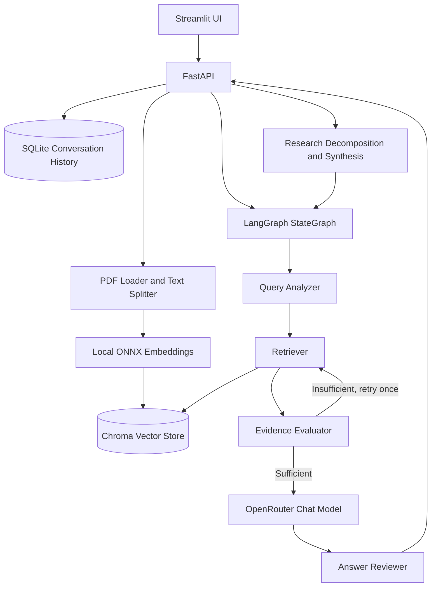

# ResearchFlow AI

ResearchFlow AI is a document-grounded research assistant built with Python, LangChain, LangGraph, FastAPI, ChromaDB and Streamlit.

## Features

- PDF upload, validation, page extraction and recursive text chunking.
- Persistent Chroma vector storage with local ONNX embeddings (no paid embedding API or PyTorch requirement).
- LangChain retrieval-augmented generation (RAG).
- LangGraph workflow: query analysis -> retrieval -> evidence evaluation -> one retry when needed -> answer generation -> answer review.
- Source metadata and page-level references in answers.
- Multi-question research mode: decomposes a broad question, gathers evidence for each sub-question and synthesizes findings, contradictions, limitations and open questions.
- SQLite conversation and message history, including selecting an earlier conversation in the UI.
- Streamlit dashboard, document library, AI chat, research workspace and workflow trace.
- Automated tests using mocked LLM/retriever dependencies where appropriate.

## Architecture



## Requirements

- Windows 10/11
- Python 3.14 (the current dependency set was installed and tested on Python 3.14).
- OpenRouter API key for live answer generation.
- Internet connection for dependency installation and first-time local embedding model initialization.

## Windows PowerShell setup

```powershell
cd D:\AI-Projects\ResearchFlow-AI
py -3.14 -m venv .venv
.\.venv\Scripts\Activate.ps1
python -m pip install --upgrade pip
pip install -r requirements.txt
Copy-Item .env.example .env
```

Edit .env and set OPENROUTER_API_KEY. The default chat model is OpenRouter's free-model router; replace it with any chat model enabled for your account if needed. Embeddings run locally through Chroma's default ONNX embedding function.

## Run backend

```powershell
uvicorn app.main:app --reload --host 127.0.0.1 --port 8000
```

API docs: http://127.0.0.1:8000/docs

## Run frontend (second terminal)

```powershell
cd D:\AI-Projects\ResearchFlow-AI
.\.venv\Scripts\Activate.ps1
streamlit run frontend/streamlit_app.py
```

Open http://localhost:8501.

## Run tests

```powershell
pytest -q
```

## API endpoints

| Method | Endpoint | Purpose |
|---|---|---|
| GET | /health | Health check |
| POST | /documents/upload | Upload and index a PDF |
| GET | /documents | List indexed documents |
| DELETE | /documents/{document_id} | Delete document chunks and uploaded file |
| POST | /chat | Ask a question using retrieved evidence |
| POST | /research | Decompose a research question and synthesize a sourced report |
| GET | /conversations | List saved conversations |
| GET | /conversations/{id}/messages | Read conversation messages |

## Resume description

Developed ResearchFlow AI, a document intelligence application using Python, LangChain, LangGraph, FastAPI and ChromaDB. Implemented PDF ingestion, local vector embeddings, semantic retrieval, evidence-aware stateful workflows with conditional retry, multi-step research decomposition, source-attributed question answering and a Streamlit interface with SQLite conversation history.

Only list features and technologies that have been run and verified in your environment.

## Screenshots

Add screenshots of the Dashboard, Document Library, AI Chat and Research Workspace here after the UI review.

## Current limitations

- Live answer generation requires a valid OpenRouter API key and an available chat model.
- The local ONNX embedding model downloads on first use (already downloaded on the development laptop).
- Research mode uses only PDFs indexed in the local knowledge base; it does not perform external web search.
- This is a local single-user prototype; authentication, deployment hardening and production observability are future work.
